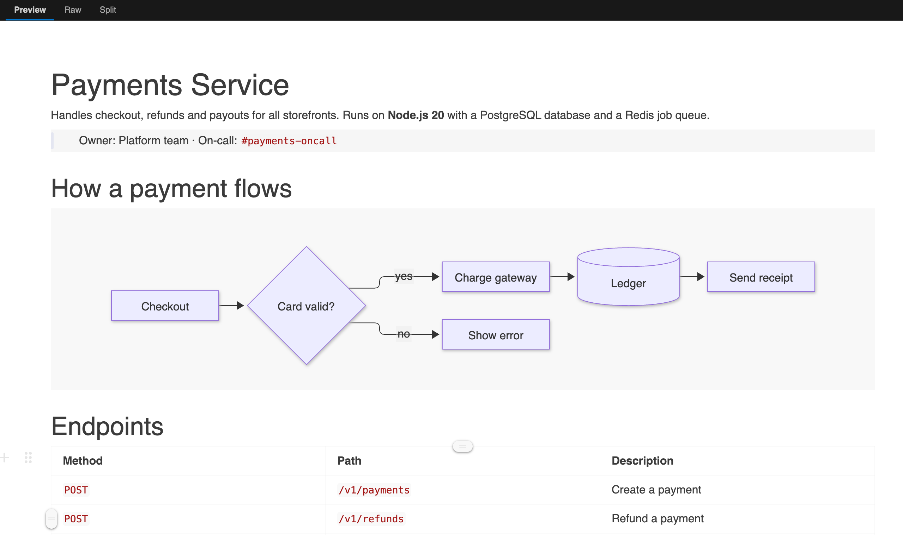
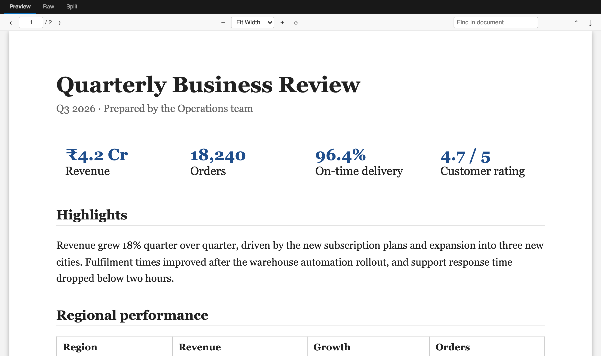
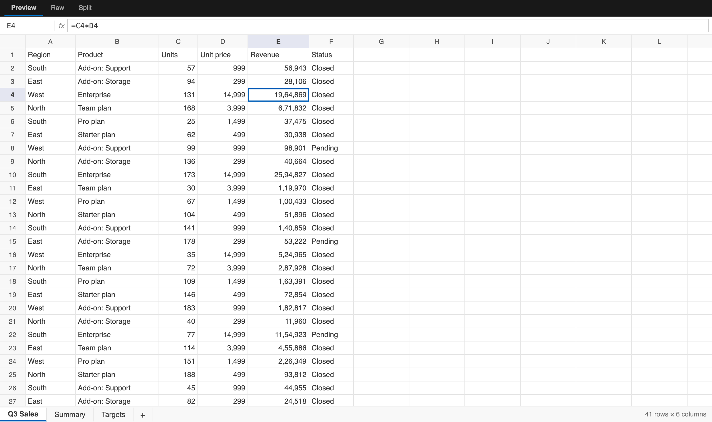
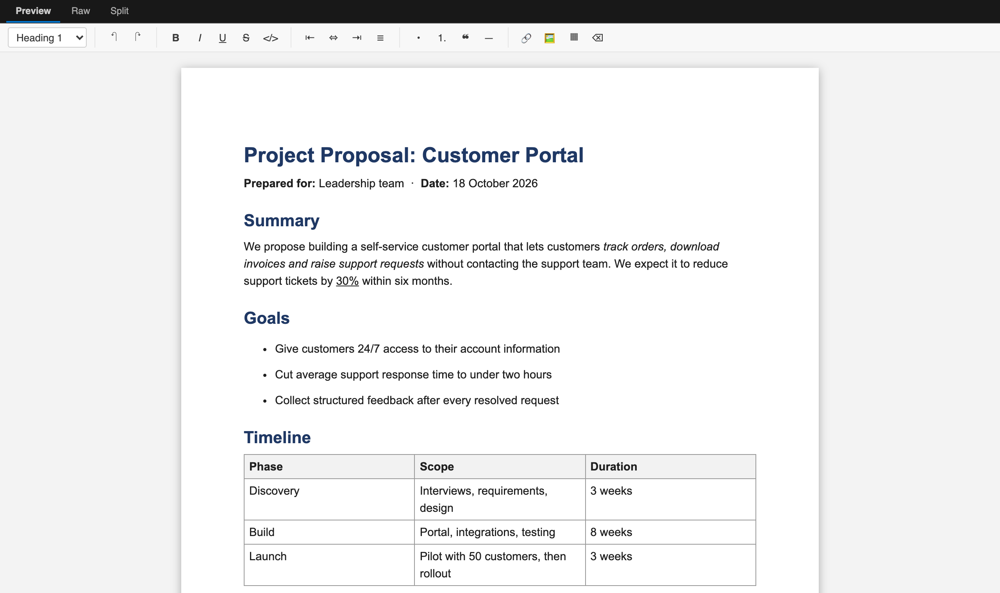
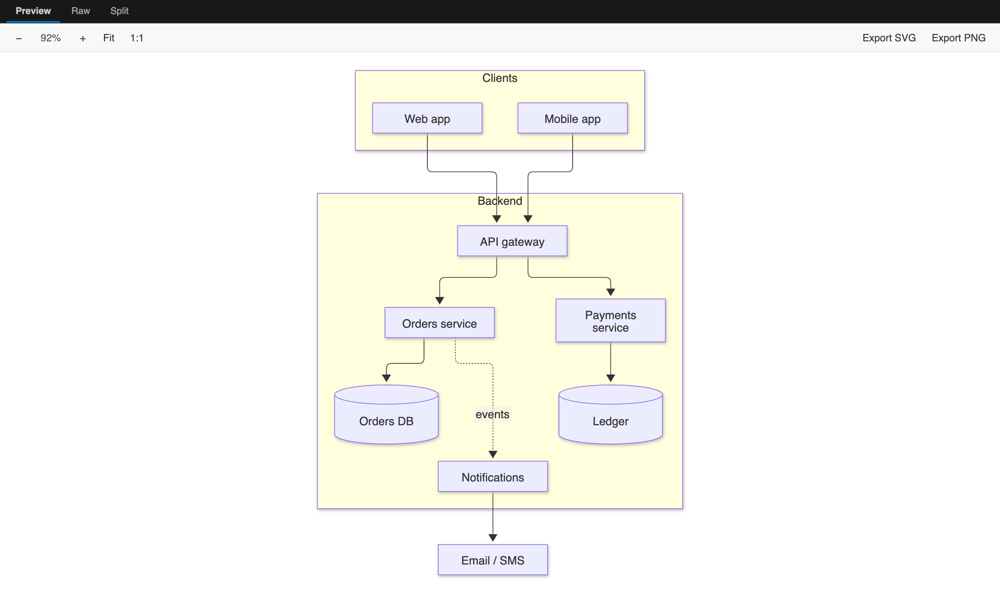
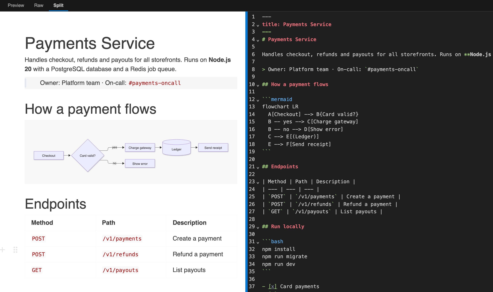

# DocDeck – PDF, Excel, Word, Markdown & Mermaid Viewer

Open PDFs, spreadsheets, Word documents, Markdown and Mermaid diagrams right inside **VS Code**, **Cursor** and **Antigravity**, without switching apps. View them, edit them and save them back, all offline.



## Supported files

| Files | What you get |
| --- | --- |
| `.pdf` | Fast PDF viewer with search, zoom and page navigation |
| `.xlsx` `.xlsm` `.xls` `.ods` `.csv` `.tsv` | Spreadsheet editor with sheets, formulas and copy/paste |
| `.docx` | Word document editor that saves back to `.docx` |
| `.md` `.markdown` | WYSIWYG Markdown editor with live Mermaid diagrams |
| `.mmd` `.mermaid` | Mermaid diagram viewer with SVG/PNG export |

Click a file and it opens in DocDeck. Every editor has three tabs: **Preview**, **Raw** and **Split**.

## PDF viewer



- Zoom with the toolbar, **Ctrl/Cmd + mouse wheel** or **Ctrl/Cmd + `+` / `-`**. Fit to page or width.
- Jump to any page, rotate pages, and select and copy text.
- Search the whole document with **Ctrl/Cmd+F**, with every match highlighted.
- Opens password-protected PDFs.
- Reloads automatically when the file changes on disk, which is handy for generated reports.

## Spreadsheets



- Handles large files smoothly (100,000+ rows).
- Edit any cell: type to replace, **Enter** or **F2** to edit, **Tab** and the arrow keys to move.
- The formula bar shows the formula behind each value, e.g. `=C4*D4`.
- Copy and paste ranges to and from Excel or Google Sheets.
- Right-click to insert or delete rows and columns. Drag column edges to resize.
- Add, rename and delete sheets from the tabs at the bottom.
- Full undo/redo, Save and Save As. Hot exit keeps unsaved changes if the editor closes.
- CSV and TSV values are kept exactly as typed: leading zeros like `00123` and long numbers aren't reformatted.

## Word documents



- A page-style editor with headings, bold, italic, underline, strikethrough, alignment, lists, quotes, links, images and tables.
- Saves straight back to `.docx`.
- Before overwriting a file for the first time, DocDeck asks whether to overwrite it or save a copy (see [Good to know](#good-to-know)).

## Markdown

- Edit Markdown like a document: type `/` for blocks, drag the handle to move them, and use the toolbar that appears on selected text.
- Tables, task lists, LaTeX math and code blocks with syntax highlighting.
- ` ```mermaid ` code blocks render as diagrams.
- YAML front matter is kept untouched.
- Images with relative paths, like `./images/diagram.png`, display. **Ctrl/Cmd+click** a link to open it; links to other `.md` files open in the editor.

## Mermaid diagrams



- `.mmd` and `.mermaid` files render as diagrams and update as you type.
- Drag to pan; **Ctrl/Cmd + wheel** to zoom; **Fit** and **1:1** buttons.
- Syntax errors are shown under the diagram while the last good version stays visible.
- **Export SVG** or **Export PNG** in one click.

## Preview, Raw and Split



- **Preview** is the rendered document. Previews always use a light theme, so documents look the way they will on paper, even when your editor is dark.
- **Raw** is the file as plain text, with line numbers and search.
  - **Markdown, Mermaid, CSV and TSV:** fully editable. Changes show up in Preview.
  - **PDF, Excel and Word:** the raw bytes, read-only, since these are binary formats.
- **Split** shows both side by side. Drag the divider to resize. Edits on either side appear on the other as you type.

Press **Ctrl/Cmd+Alt+R** to switch between Preview and Raw.

## Settings

| Setting | Default | Description |
| --- | --- | --- |
| `docdeck.defaultView` | `preview` | Which tab files open on: `preview`, `raw` or `split` |
| `docdeck.docx.confirmBeforeSave` | `true` | Ask before overwriting a `.docx` file (see below) |

To open a file type in the plain text editor instead, right-click a file → **Open With… → Configure default editor for '\*.md'** (or any other extension) and choose **Text Editor**. From a Markdown or Mermaid file, the **Open Source Text** button in the editor title bar opens the text editor beside DocDeck, and the two stay in sync.

## Good to know

- **Word files are rebuilt when saved.** Text, headings, lists, tables, links, images and basic formatting are kept. Headers and footers, comments, tracked changes, custom styles and exact page layout are not. That's why DocDeck asks before overwriting the original and offers to save a copy instead.
- **Spreadsheet formulas are saved, not calculated.** Existing results show as saved in the file. A new or edited formula shows its text until the file is opened in Excel, LibreOffice or Google Sheets. Cell colours and fonts aren't kept when saving `.xlsx`.
- **CSV and TSV** files use their first sheet only.
- **Markdown formatting may be tidied** after your first edit (for example `*` bullets become `-`). The content itself doesn't change.

## Privacy

DocDeck runs entirely on your machine. It doesn't upload your files and collects no telemetry. The only network requests are for images that a Markdown file links from the internet.

## Requirements

VS Code 1.90 or later, or a compatible editor such as Cursor, Antigravity, Windsurf or VSCodium.

## Feedback

Found a bug or have an idea? [Open an issue](https://github.com/vishalpatil12014017/DocDeck/issues).

## Building from source

```bash
git clone https://github.com/vishalpatil12014017/DocDeck.git
cd DocDeck
npm install
npm run build        # bundle into dist/ (npm run watch to rebuild on change)
npm run package      # create docdeck-<version>.vsix
```

Press **F5** in VS Code to try your changes in an Extension Development Host. The extension host code is in `src/`, and each editor's UI is in `webview/`.

## License

[MIT](LICENSE) © Vishal Patil

Built with [pdf.js](https://github.com/mozilla/pdf.js), [SheetJS CE](https://sheetjs.com), [mammoth](https://github.com/mwilliamson/mammoth.js), [html-to-docx](https://github.com/TurboDocx/html-to-docx), [Tiptap](https://tiptap.dev), [Milkdown](https://milkdown.dev), [CodeMirror](https://codemirror.net) and [Mermaid](https://mermaid.js.org).
